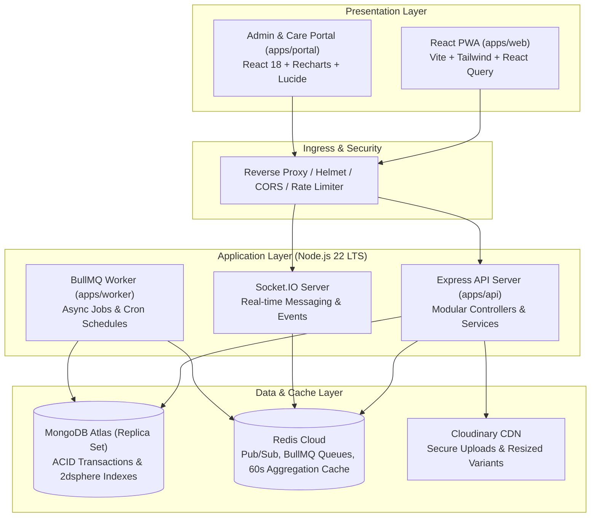
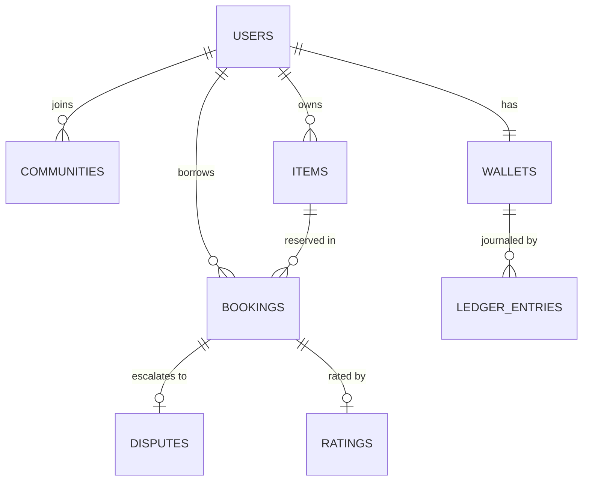

# BorrowLoop — Engineering Presentation & Defense

**CS1237 Full Stack Application Development — Semester Project**  
_Academic Term: 2026–2027_  
_Project Name:_ **BorrowLoop** — Community Peer-to-Peer Rental & Borrowing Platform  
_Repository:_ [https://github.com/Devam759/Full-Stack-Project](https://github.com/Devam759/Full-Stack-Project)  
_Live Demo URL:_ [https://borrowloop.vercel.app](https://borrowloop.vercel.app)  
_API Documentation:_ [https://borrowloop-api.onrender.com/v1/docs](https://borrowloop-api.onrender.com/v1/docs)

---

## Team Members & Responsibilities

| Student Name      | Role                                     | Core Contributions                                                                                                                                                                                                    | Viva Focus                                                                                                    |
| :---------------- | :--------------------------------------- | :-------------------------------------------------------------------------------------------------------------------------------------------------------------------------------------------------------------------- | :------------------------------------------------------------------------------------------------------------ |
| **Team Member 1** | **Backend Core & Financial Ledger**      | MongoDB Mongoose Schema design, Double-entry append-only ledger (`LedgerEntry`, `Wallet`), Booking state machine, MongoDB multi-document ACID transactions, Zod validation, RFC 9457 standard errors.                 | Ledger invariant proofs, ACID isolation levels, Idempotency pattern, State machine transitions.               |
| **Team Member 2** | **Frontend Client & UI/UX**              | React 18 SPA (Vite + Tailwind CSS), Item catalog with geospatial `$geoWithin` distance bands, Community discovery & membership flows, PWA service worker, blind two-sided rating flow, Toast & error feedback states. | React Hooks, Context API architecture, Geospatial distance calculations, Responsive UI patterns, PWA caching. |
| **Team Member 3** | **Platform Portals, Real-Time & DevOps** | Customer Care & Admin Portal (`apps/portal`), Real-time Socket.IO with Redis Adapter, BullMQ async background queues, Redis caching, 18 Vitest test suites, GitHub Actions CI/CD automation.                          | Socket room lifecycle & horizontal scaling, Redis caching strategies, Worker outbox pattern, CI/CD pipeline.  |

---

## Slide 1: Problem Statement & Target Personas

### The Real-World Problem

Every semester, students, campus residents, and community members purchase expensive, seldom-used items:

- Heavy-duty tools (drills, car battery jumpers)
- Audio/video equipment (DSLR cameras, ring lights, microphones)
- Textbooks, lab kits, and camping gear

These items sit idle 95% of the year. Traditional peer lending is fraught with **risk, lack of trust, zero financial safety nets, and no dispute resolution**.

### User Personas

1. **The Borrower (Student / Resident)**: Needs high-value items temporarily at a fraction of retail cost, wanting guaranteed escrow protection against faulty goods.
2. **The Lender (Owner)**: Wants to monetize idle equipment safely with a secured deposit held in escrow and automated late-return penalties.
3. **The Customer Care Agent**: Mediates disputes, reviews evidence (time-stamped handover photos), issues binding resolutions.
4. **The Platform Administrator**: Analyzes platform liquidity, enforces community moderation, audits ledger reconciliation, and manages commission revenues.

---

## Slide 2: System Architecture & Technology Stack

### Technology Stack Justification

- **Frontend**: React 18 with Vite for sub-second HMR and minimal bundle footprint. Tailwind CSS for utility-first responsive design.
- **Backend**: Node.js 22 LTS + Express. Plain ES modules throughout (zero TypeScript transpile overhead, clean ESM standards).
- **Database**: MongoDB Mongoose with a replica set to leverage **multi-document ACID transactions** for money transfers.
- **Cache & Message Broker**: Redis for rate limiting, distributed session storage, Socket.IO adapter broadcasting, and BullMQ queue scheduling.

---

## Slide 3: Database Design & Double-Entry Ledger

### Database Modeling & Relationships

12+ normalized and indexed Mongoose models designed for high concurrency:

- `users`: Core identity, password hash (argon2/bcrypt), trust score, email verification state, role (`user`, `agent`, `admin`).
- `communities`: Geographic campus/neighborhood boundary (`Point` GeoJSON, 2dsphere indexed).
- `items`: Lending catalog with category, price in integer paise, rounded coordinates, compound index `{ communities: 1, status: 1 }`.
- `bookings`: Finite state machine (`requested` → `accepted` → `picked_up` → `returned` → `completed` / `disputed`).
- `wallets`: User available, frozen (escrow), and pending balances in integer paise.
- `ledger_entries`: **Append-only immutable double-entry journal**. No balance is ever altered directly.

### The Financial Invariant (Zero-Sum Double Entry)

$$\sum \text{Credits} - \sum \text{Debits} = 0$$

- Every rupee is stored strictly as **integer paise** (₹1.00 = 100 paise) to eliminate IEEE 754 floating-point rounding errors.
- Every money movement runs inside a MongoDB transaction with a verified `Idempotency-Key` header.
- Continuous ledger reconciliation verifies that `wallets.availablePaise + wallets.frozenPaise == sum(ledger_entries)`.

---

## Slide 4: Core User Flows & Live Demo Walkthrough

### 1. Item Discovery & Geospatial Search

- Borrower searches items using query keywords and filters by distance radius.
- Backend runs MongoDB `$geoWithin` against 2dsphere indexes. Coarse distance bands (`< 2 km`, `2–5 km`) protect owner privacy; exact coordinates are never leaked to clients.

### 2. Booking Request & Escrow Lock

- Borrower selects dates on the calendar availability matrix.
- `POST /v1/bookings` runs inside an ACID transaction:
  1. Checks for conflicting date locks (`BookingDateLock`).
  2. Verifies wallet available balance $\ge \text{Rent} + \text{Deposit}$.
  3. Moves funds from `available` to `frozen` escrow via double-entry ledger.
  4. Returns booking in `requested` status.

### 3. Handover & Two-Sided QR Verification

- Lender & borrower meet in person.
- One scans the dynamic, time-limited QR code generated by the other party.
- State automatically transitions to `picked_up` (rent countdown begins).

### 4. Return, Automated Settlement & Blind Ratings

- On return, lender confirms condition via return QR.
- Ledger automatically:
  - Deducts rent from escrow and transfers $(1 - \text{commission})$ to lender's available balance.
  - Credits platform commission to `platform_revenue`.
  - Unfreezes and refunds the security deposit to borrower's available balance.
- Both users enter a **blind rating window** (reviews stay hidden until both submit or 7 days elapse to prevent retaliatory scores).

---

## Slide 5: Advanced Features Deep Dive (Part C Evaluation)

BorrowLoop implements **8 of the 9 Advanced Features** listed in the CS1237 syllabus:

| Feature                                        | What It Does                                                               | Why It Was Needed                                                                      | How It Was Implemented                                                                                 |
| :--------------------------------------------- | :------------------------------------------------------------------------- | :------------------------------------------------------------------------------------- | :----------------------------------------------------------------------------------------------------- |
| **1. Double-Entry Ledger & ACID Transactions** | Enforces zero-sum financial accountability.                                | Direct balance editing leads to race conditions, currency drift, and financial fraud.  | MongoDB replica set transactions + `LedgerEntry` append-only collections + `Idempotency-Key` tracking. |
| **2. Interactive Swagger / OpenAPI Docs**      | Live interactive browser testing for all REST endpoints at `/v1/docs`.     | Evaluators and external developers can test payloads, status codes, and auth directly. | OpenAPI 3.0 specification served via `swagger-ui-express` mounted in Express.                          |
| **3. Real-Time Socket.IO with Redis Adapter**  | Live in-app messaging, handover state updates, and push alerts.            | Polling the database every few seconds wastes bandwidth and introduces latency.        | Socket.IO server connected to `@socket.io/redis-adapter` for multi-process scaling.                    |
| **4. Data Visualization Analytics**            | Admin charts showing volume, active bookings, and dispute ratios.          | Executives need at-a-glance visualization of platform growth and health.               | Recharts responsive charts powered by MongoDB `$facet` aggregation pipelines.                          |
| **5. Caching Layer (Redis)**                   | Caches item catalog queries and executive analytics with 60s TTL.          | Aggregation over millions of documents can degrade MongoDB throughput.                 | Redis `ioredis` cache-aside middleware with automatic cache invalidation on mutations.                 |
| **6. Background Queues & Cron (BullMQ)**       | Auto-expires unaccepted bookings, sweeps late returns, reconciles ledgers. | Long-running jobs must not block HTTP request-response cycles.                         | BullMQ queues backed by Redis with worker processes executing background jobs.                         |
| **7. File Uploads via CDN (Cloudinary)**       | Direct-to-cloud signed image uploading with automated resizing variants.   | Storing raw images on application servers consumes disk space and hurts performance.   | `POST /v1/uploads/sign` creates signed HMAC requests; browser uploads directly to Cloudinary CDN.      |
| **8. Two-Factor Authentication (TOTP)**        | Protects staff portal accounts (`agent`, `admin`) with 6-digit TOTP codes. | Privileged accounts require defense-in-depth against credential theft.                 | RFC 6238 TOTP engine (`otpauth`) verified in two-step portal login handshake.                          |

---

## Slide 6: Security, Testing & DevOps Excellence

### Security Best Practices Implemented

- **Zod Strict Schema Validation**: Every query param, path variable, and request body is parsed and stripped of untrusted fields.
- **IDOR & Mass Assignment Protections**: Explicit field whitelists prevent users from modifying roles, balances, or others' resources.
- **RFC 9457 Error Standard**: Clean error responses that never leak stack traces or database internal names.
- **Defense in Depth**: Helmet security headers, CORS origin whitelisting, HTTP-only JWT cookies, and sliding window rate limiting.

### Testing Architecture (18 Automated Test Suites)

- **Unit Tests**: Business formulas (fees, late penalties, trust score recalculation).
- **Concurrency & Race Tests**: Parallel booking attempts on the exact same item and dates; verify only 1 succeeds and 0 double-spends occur.
- **Idempotency Tests**: Replaying requests with the same `Idempotency-Key` returns identical responses without double-charging.
- **Multi-Process Integration Tests**: Verifies API and Worker processes communicating seamlessly via outbox queues and Redis.
- **GitHub Actions CI**: Every commit runs ESLint, Prettier, and Vitest test suites on Node 22.

---

## Slide 7: Challenges Faced, Learnings & Viva Defense

### Key Technical Challenges Solved

1. **Preventing Double Booking in High Concurrency**:
   - _Challenge_: Simultaneous requests for the same date range could both pass validation before writing.
   - _Solution_: Atomic date-lock collection (`BookingDateLock`) with a unique compound index on `(itemId, date)` inside an active MongoDB transaction.
2. **Preventing Inconsistent Ledger States during Crashes**:
   - _Challenge_: A server crash mid-settlement could credit the lender without debiting escrow.
   - _Solution_: Both legs of every ledger movement are executed in a single atomic transaction; continuous reconciliation detects any anomaly within 60 seconds.
3. **Real-time Horizontal Scaling**:
   - _Challenge_: Sockets connected to Server A could not reach users connected to Server B.
   - _Solution_: Integrated Redis Pub/Sub adapter to broadcast room events seamlessly across multiple Node instances.

### Viva Q&A Quick Reference

- **Why MERN over relational SQL?** Flexible schema for diverse item categories combined with MongoDB 4.0+ ACID multi-document transactions provides the best of document modeling and transactional consistency.
- **Why integer paise instead of floating point?** Floating point numbers in JavaScript (`0.1 + 0.2 = 0.30000000000000004`) introduce rounding drift. Integer paise ensures exact arithmetic down to the last cent.
- **Why BullMQ instead of standard setInterval?** Distributed queues persist jobs across server restarts, support delayed retries with exponential backoff, and prevent duplicate executions across clustered instances.

---

_Thank you! We invite the faculty panel for questions and the live demonstration._
